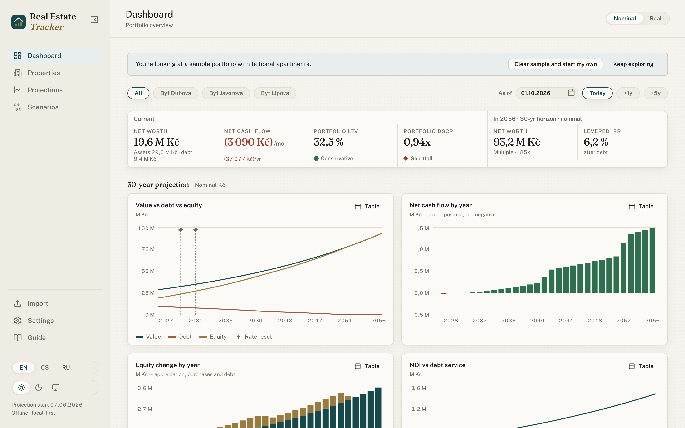
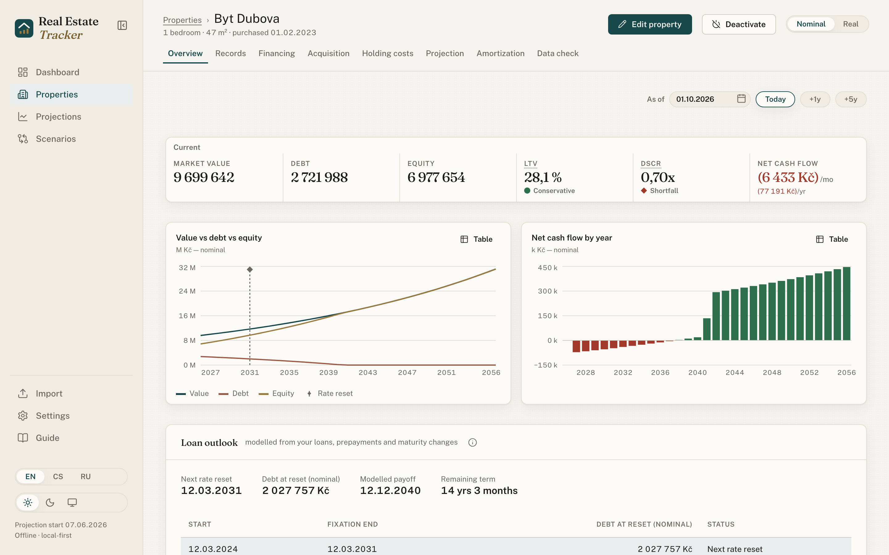
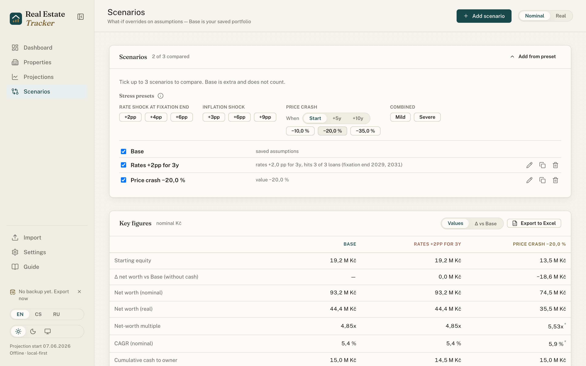
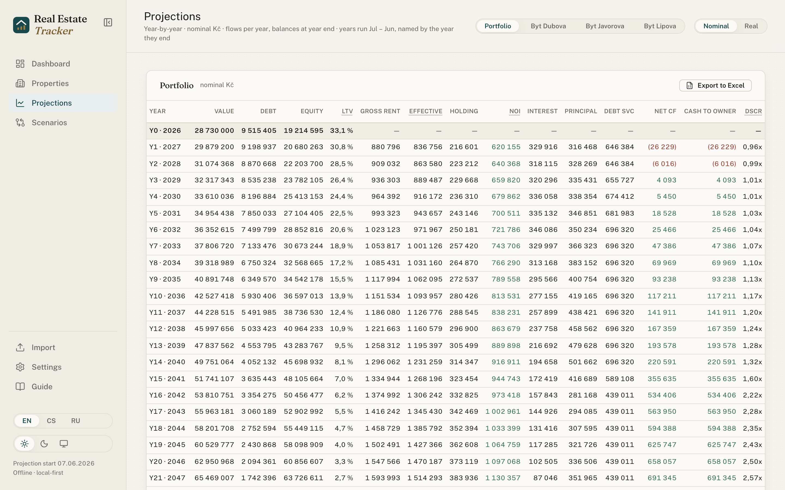
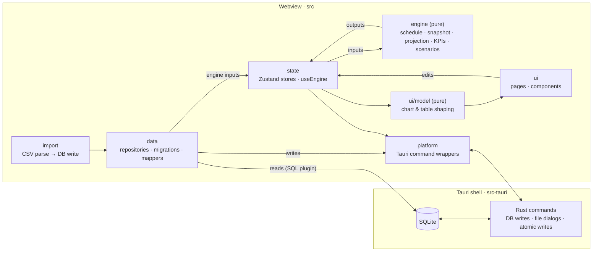

<div align="center">


# Real Estate Tracker

**A private Mac app for owners of Czech rental apartments: track mortgages, leases, valuations
and costs, and see where the portfolio is heading over the next 30 years.**

[Who it's for](#who-its-for) · [Current limits](#current-limits) · [Install](#install) ·
[Start your own portfolio](#start-your-own-portfolio) · [Features](#features) ·
[Documentation](#documentation)

[](https://github.com/vlastimilbures/real-estate-tracker/actions/workflows/ci.yml)
[](https://github.com/vlastimilbures/real-estate-tracker/releases)
[](LICENSE)


</div>

<br>

<picture>
  <source media="(prefers-color-scheme: dark)" srcset="docs/screenshots/dashboard-dark.png">
  
</picture>

<sub>All figures in the screenshots come from the built-in fictional sample portfolio.</sub>

## Who it's for

- **One owner of a few rental flats in Czechia**, financed with Czech annuity mortgages, who
  keeps the records on one Mac.
- **Comfortable with the numbers** — LTV, DSCR, yields, fixation and rate resets — and wants
  them computed correctly rather than in a fragile spreadsheet.
- **Planning, not bookkeeping** — projections and what-if scenarios, not a bank
  ledger, accounting or tax return.

## Current limits

- **Platform:** macOS 13 or later on Apple Silicon. Offline and single-user; no sync or sharing.
- **Currency:** Czech koruna (Kč) only, with Czech number, date and currency formatting. The
  interface is in English, Czech or Russian.
- **Mortgages:** Czech annuity practice — fixation periods and a rate reset at each fixation
  end. One active loan block per property at a time (refinancing is a successor block).
- **Estimates, not quotes:** figures are planning projections, not lender quotes or valuations.
  Returns are measured from the projection start, not from your purchase.
- **Not modelled:** income or capital-gains tax, the annual penalty-free prepayment allowance
  and a bank-account ledger.
  Selling costs only lower the levered IRR (a rate in Settings → Assumptions, 0 % unless set).

[Model assumptions & limitations](docs/model-limitations.md) lists everything the model
simplifies or leaves out.

## Install

Download the latest `.dmg` from [Releases](https://github.com/vlastimilbures/real-estate-tracker/releases)
(Apple Silicon, macOS 13 or later) and drag the app to Applications.

The app is ad-hoc signed, not notarized, so macOS blocks the first launch. Allow this one app:

- **macOS 15+:** open the app once, then **System Settings → Privacy & Security → Open Anyway**.
- **macOS 13–14:** Control-click the app in Finder → **Open** → **Open**.

Do not turn Gatekeeper off globally; the steps above allow only this app. Details are in
[Gatekeeper on another Mac](docs/release.md#gatekeeper-on-another-mac).

Your data lives in `~/Library/Application Support/com.bures.realestate-tracker/` — see
[Privacy & security](#privacy--security).

**Before installing a new version,** export a backup (**Settings → Backup & Restore → Export
backup…**). [Data safety & recovery](docs/data-safety.md) covers backups, restore and what to do
if an upgrade fails.

### Build from source

The second way in, for developers. You need:

| Requirement              | Version                                                        |
| ------------------------ | -------------------------------------------------------------- |
| macOS                    | 13 or later, Apple Silicon                                     |
| Xcode Command Line Tools | `xcode-select --install`                                       |
| Rust                     | 1.96.0 via [rustup](https://rustup.rs) (`rust-toolchain.toml`) |
| Node.js                  | 24 or later (`package.json` `engines`)                         |
| pnpm                     | 11.5.0 (`packageManager`; `corepack enable` installs it)       |

```bash
git clone https://github.com/vlastimilbures/real-estate-tracker.git
cd real-estate-tracker
corepack enable              # pnpm at the pinned version
pnpm install                 # dependencies + git hooks
pnpm typecheck && pnpm test  # clean-run check: both must pass
pnpm tauri dev               # run the app with hot reload
scripts/release-macos.sh     # build, ad-hoc sign and verify a release bundle
```

> [!TIP]
> `pnpm tauri dev` opens your real database. To work on the UI without touching it, run
> `pnpm ux:capture` — it renders every screen in a browser on an in-memory copy of the sample
> portfolio.

## Start your own portfolio

On first launch the app fills in a **fictional sample portfolio** so every screen has data.
To switch to your own:

1. **Remove the sample.** Click **Clear sample and start my own** in the banner on the
   **Dashboard** or **Properties** page (or in **Settings → Backup & Restore**). The app saves a
   safety copy first, then deletes the three sample apartments and everything under them.
   Properties you added yourself, a sample apartment you renamed, your assumptions and
   scenarios are kept.
2. **Set your assumptions.** In **Settings → Assumptions**, set the base date, horizon,
   appreciation, rent indexation, inflation, vacancy, post-fixation reset rate and
   holding-cost defaults.
3. **Add your properties.** Use **Properties → Add property**, or load several at once from CSV
   files on the **Import** page — see the [CSV import guide](docs/csv-import.md) for the
   columns, examples and matching rules.
4. **Add the details.** On each property, enter the mortgage, leases, valuations and holding
   costs.
5. **Review.** Check the **Dashboard**, **Projections** and **Scenarios** pages; the figures
   update as you edit.
6. **Export a backup.** **Settings → Backup & Restore → Export backup…** saves everything to
   one file. Keep it somewhere safe — see [Data safety & recovery](docs/data-safety.md).

## Why

Spreadsheets are a fine start for a few rental flats, but they get fragile once loans have
fixation periods, rents change mid-year and you want to ask "what if rates jump 2 points when
the next fixation ends?". Real Estate Tracker is a desktop app with a **pure, tested financial
engine**: it amortizes Czech annuity mortgages month by month, follows leases and valuations
by date, and projects value, rent, cash flow and net worth for 30 years in **nominal and
real** terms. Everything runs and stays on your Mac.

## Features

**Portfolio & mortgages**

- 1…N properties, each with effective-dated valuations, leases and holding costs
- Czech annuity loans with **fixation and rate reset** on the loan's own due dates
- Refinancing by successor blocks, **development loans** (tranche draws, interest-only
  period), future-dated purchases with partial-year pro-rating
- One-off prepayments (lower the instalment or shorten the term) and maturity changes, with
  the interest they save
- Optional contract maturity date: the loan panel warns when the instalment implies a
  different maturity or a fixation ended without a follow-on block

**Analysis**

- **30-year projections** of value, debt, equity, rent, NOI and cash flow — nominal or real
  (cumulative CPI index, so inflation shocks deflate correctly)
- KPIs: LTV, DSCR, gross/net yield, net-worth multiple and CAGR, **levered IRR**,
  first cash-flow-positive year, debt-free year
- **As-of lens** — view the portfolio on any date in the projection window
- **Scenarios** — named assumption overrides, temporary rate and inflation shocks, value
  haircuts, one-click stress presets and side-by-side comparison

**Data**

- **CSV import** for properties, valuations, leases and mortgages — all-or-nothing, with
  per-row, per-column messages ([guide](docs/csv-import.md))
- **JSON backup & restore** with validation and an automatic safety backup
- **Excel export** of projection, amortization and scenario-comparison tables

**App**

- English, Czech and Russian UI; Czech number, date and currency formatting
- Light, dark and system themes; keyboard navigation and macOS menu shortcuts
- Automated accessibility checks: axe (WCAG 2.2 AA rules) on every screen in CI, in English,
  light and dark — see [Quality](#quality)

## Screenshots

<table>
  <tr>
    <td width="50%">
      <picture>
        <source media="(prefers-color-scheme: dark)" srcset="docs/screenshots/property-detail-dark.png">
        
      </picture>
      <p align="center"><b>Property detail</b> — value, debt and cash flow over time</p>
    </td>
    <td width="50%">
      <picture>
        <source media="(prefers-color-scheme: dark)" srcset="docs/screenshots/scenarios-dark.png">
        
      </picture>
      <p align="center"><b>Scenarios</b> — stress presets compared with Base</p>
    </td>
  </tr>
  <tr>
    <td colspan="2">
      <picture>
        <source media="(prefers-color-scheme: dark)" srcset="docs/screenshots/projections-dark.png">
        
      </picture>
      <p align="center"><b>Projections</b> — year-by-year grid for the portfolio or a single property</p>
    </td>
  </tr>
</table>

## Privacy & security

- **Offline by design** — no network calls, analytics or updater. A strict Content Security
  Policy and a navigation guard keep the webview on the app.
- **Least privilege** — the webview can open the database and read it through the SQL
  plugin, listen for menu events and call the app's own commands, nothing else. Every write
  runs in the app's own Rust commands. The plugin's read is not a read-only guarantee (see
  [Security posture](docs/release.md#security-posture)). File dialogs open in Rust, so the
  webview never passes a file path.
- **Your data stays on your Mac:**

  | What                           | Location                                                              |
  | ------------------------------ | --------------------------------------------------------------------- |
  | Database                       | `~/Library/Application Support/com.bures.realestate-tracker/`         |
  | Automatic backups              | `~/Library/Application Support/com.bures.realestate-tracker/backups/` |
  | Error log (rotating, 5 × 1 MB) | `~/Library/Logs/com.bures.realestate-tracker/app.log`                 |

  These folders are readable only by your user (`0700`), and the data, backup and log
  files are `0600`. A log file the app starts mid-session (rotation) is `0644` inside the
  `0700` folder until the next start. Nothing is encrypted beyond FileVault.
  How to back up and recover: [Data safety & recovery](docs/data-safety.md).

Found a vulnerability? Please report it privately — see [SECURITY.md](SECURITY.md).

## Quality

What the checks do and do not prove:

- **Arithmetic.** Money uses exact decimal arithmetic; results are rounded only for display.
- **Engine figures.** Two independent models, written from the specification without the
  engine's code, check the mortgage maths and the sample portfolio's projection and KPIs.
  Parity targets pin the sample's figures within ±1 Kč (money) and ±0.0001 (ratios); the
  money targets are the engine's own values, so they catch a change rather than prove a
  figure. A golden master
  catches any other change. A target changes only through an ADR, recorded in the
  [target change log](.claude/rules/engine-parity.md#target-change-log). These tests show the
  formulas run as specified; they do not show that the economic assumptions are right — see
  [Model assumptions & limitations](docs/model-limitations.md).
- **Accessibility.** axe (WCAG 2.2 AA rules) runs in CI on every screen in English, light and
  dark, at two window sizes ([workflow](.github/workflows/ci.yml)). Automated checks
  complement but do not replace manual keyboard and screen-reader testing.

The table below is generated from `scripts/gates.mjs`, the one gate list (what each gate
does locally is in [CONTRIBUTING.md](CONTRIBUTING.md#checks)). `pnpm check` runs the
local gates in order.

<!-- gates:start -->

| Command                                                                                                                                             | Checks                                                                                                | Runs in                  |
| --------------------------------------------------------------------------------------------------------------------------------------------------- | ----------------------------------------------------------------------------------------------------- | ------------------------ |
| `pnpm exec prettier --check .`                                                                                                                      | Prettier formatting                                                                                   | `pnpm check`, CI         |
| `pnpm typecheck`                                                                                                                                    | TypeScript strict                                                                                     | `pnpm check`, CI         |
| `pnpm lint`                                                                                                                                         | ESLint with zero warnings, incl. engine-purity rules; function sizes; comment references; stylesheets | `pnpm check`, CI         |
| `pnpm depcruise`                                                                                                                                    | Layer map and cycles                                                                                  | `pnpm check`, CI         |
| `pnpm depcruise:baseline-check`                                                                                                                     | The layer-violation baseline never grows                                                              | `pnpm check`, CI         |
| `pnpm lint:size:baseline-check`                                                                                                                     | The function-size baseline never grows                                                                | `pnpm check`, CI         |
| `pnpm knip`                                                                                                                                         | Unused files, exports and dependencies                                                                | `pnpm check`, CI         |
| `pnpm knip:prod`                                                                                                                                    | The same for the shipped app: an export only tests use is dead                                        | `pnpm check`, CI         |
| `pnpm adr:check`                                                                                                                                    | ADR index current, links paired                                                                       | `pnpm check`, CI         |
| `pnpm test:coverage`                                                                                                                                | Vitest tests with per-folder coverage floors, incl. the parity targets (±1 Kč, ±0.0001)               | `pnpm check`, CI         |
| `pnpm coverage:ratchet`                                                                                                                             | No coverage floor more than 3 points below measured                                                   | `pnpm check`, CI         |
| `cargo fmt --check --manifest-path src-tauri/Cargo.toml`                                                                                            | Rust formatting                                                                                       | `pnpm check`, CI         |
| `cargo clippy --manifest-path src-tauri/Cargo.toml --all-targets -- -D warnings`                                                                    | Rust lints, warnings are errors                                                                       | `pnpm check`, CI         |
| `cargo test --manifest-path src-tauri/Cargo.toml`                                                                                                   | Rust integration tests                                                                                | `pnpm check`, CI         |
| `pnpm audit --prod --audit-level=high`                                                                                                              | Production npm dependencies have no high advisory                                                     | `pnpm check:release`, CI |
| `(cd src-tauri && cargo audit)`                                                                                                                     | Rust dependencies have no advisory                                                                    | `pnpm check:release`, CI |
| `pnpm exec vite build`                                                                                                                              | The production frontend build                                                                         | CI                       |
| `status=0; grep -rlE 'sql-wasm\|initSqlJs' dist/assets \|\| status=$?; [ $status = 1 ]`                                                             | sql.js (E2E only) stays out of the app bundle                                                         | CI                       |
| `TZ=Pacific/Pago_Pago pnpm test`                                                                                                                    | The suite in a negative time zone                                                                     | CI                       |
| `TZ=Pacific/Kiritimati pnpm vitest run src/lib src/ui src/state`                                                                                    | The layers that read local time, in a positive time zone                                              | CI                       |
| `UX_RUN_ID=ci UX_LANG=en UX_THEME=both UX_VIEWPORT=1280x800,min pnpm ux:capture && pnpm ux:axe-check ci`                                            | axe scan of every screen: English, light and dark, two window sizes                                   | CI                       |
| `UX_RUN_ID=ci-i18n UX_LANG=cs,ru UX_THEME=light UX_VIEWPORT=1280x800,1200x800,min pnpm ux:capture --grep @layout-i18n && pnpm ux:axe-check ci-i18n` | The layout screens in Czech and Russian, three window sizes                                           | CI                       |
| `bash scripts/check-vendored-sqlx-sqlite.sh`                                                                                                        | Cargo.lock uses the vendored sqlx-sqlite, which differs from crates.io by one line                    | CI                       |
| `cargo build --manifest-path src-tauri/Cargo.toml`                                                                                                  | The Rust shell builds                                                                                 | CI                       |
| `cargo test --manifest-path src-tauri/Cargo.toml --test menu_built`                                                                                 | The AppKit menu as built matches its pin, on macOS                                                    | CI                       |
| `pnpm mutation`                                                                                                                                     | Stryker mutation score on the engine                                                                  | Weekly                   |
| `pnpm bench --outputJson bench.json && pnpm bench:check bench.json`                                                                                 | Engine performance budgets, checked by `pnpm bench:check`                                             | Nightly                  |
| `FC_RUNS=2000 pnpm exec vitest run`                                                                                                                 | Every fast-check property test with a new seed each night                                             | Nightly                  |
| `pnpm test:e2e`                                                                                                                                     | Playwright smoke tests (optional, ADR 0006; `e2e.yml`)                                                | Nightly                  |

<!-- gates:end -->

## Architecture



- **The engine is pure** — typed inputs in, typed outputs out; no IO and no clock reads
  (the base date is always a parameter). From outside its own folder the engine imports only
  the money helpers (`src/lib/money.ts`, which wraps `decimal.js`) and the shared input rules
  (`src/lib/rules.ts`).
- **Money is never a float** — `decimal.js` everywhere, stored as decimal text in SQLite and
  rounded only for display.
- **One-way data flow** — DB → mappers → engine → UI. Components never do financial arithmetic.
- **Enforced by tooling** — dependency-cruiser checks the layer map and import cycles; ESLint
  bans clocks, randomness and float parsing inside the engine.

### Project layout

| Path                                            | What lives there                                                                                                        |
| ----------------------------------------------- | ----------------------------------------------------------------------------------------------------------------------- |
| [`src/engine/`](src/engine)                     | Pure financial engine: annuity maths (PMT/FV/NPER), amortization, snapshot, projections, KPIs, scenarios, validation    |
| [`src/engine/__tests__/`](src/engine/__tests__) | Parity, invariant, property-based and golden-master tests; independent mortgage and KPI reference models                |
| [`src/data/`](src/data)                         | SQLite repositories, migrations, runtime guards, mappers, seed, backup                                                  |
| [`src/import/`](src/import)                     | CSV importer — pure parse/validate plus the DB write                                                                    |
| [`src/state/`](src/state)                       | Zustand stores, memoised engine recompute, facades the UI uses                                                          |
| [`src/ui/`](src/ui)                             | Pages, components and pure view models (`ui/model`)                                                                     |
| [`src/i18n/`](src/i18n)                         | Typed English, Czech and Russian dictionaries                                                                           |
| [`src/lib/`](src/lib)                           | Decimal setup and helpers, shared input rules, local-day helpers and display formatting                                 |
| [`src/platform/`](src/platform)                 | Wrappers around the app's Tauri commands                                                                                |
| [`src-tauri/`](src-tauri)                       | Rust shell: DB writes and transactions, error codes, backups, file dialogs, atomic writes, menu, navigation guard, logs |
| [`ux-capture/`](ux-capture)                     | Screenshot + axe harness for every screen                                                                               |
| [`docs/`](docs)                                 | Architecture decision records, release guide, design notes, roadmap                                                     |

## Documentation

| Document                                               | Contents                                                          |
| ------------------------------------------------------ | ----------------------------------------------------------------- |
| [SPEC.md](SPEC.md)                                     | Product and engine specification: domain model, formulas, screens |
| [docs/adr/](docs/adr/README.md)                        | Architecture decision records                                     |
| [docs/model-limitations.md](docs/model-limitations.md) | What the figures mean and what the model leaves out               |
| [docs/data-safety.md](docs/data-safety.md)             | Backup, restore and recovery after a failed upgrade               |
| [docs/csv-import.md](docs/csv-import.md)               | CSV import: columns, examples, matching and all-or-nothing rules  |
| [docs/roadmap.md](docs/roadmap.md)                     | Planned work and engineering backlog                              |
| [docs/release.md](docs/release.md)                     | Building, signing, Gatekeeper, data locations                     |
| [CONTRIBUTING.md](CONTRIBUTING.md)                     | Setup, checks, commit style, decision process                     |
| [CHANGELOG.md](CHANGELOG.md)                           | User-visible changes per release                                  |
| [CLAUDE.md](CLAUDE.md)                                 | Engineering rules, also used for AI-assisted work                 |

## License

[MIT](LICENSE) © 2026 Vlastimil Bureš
